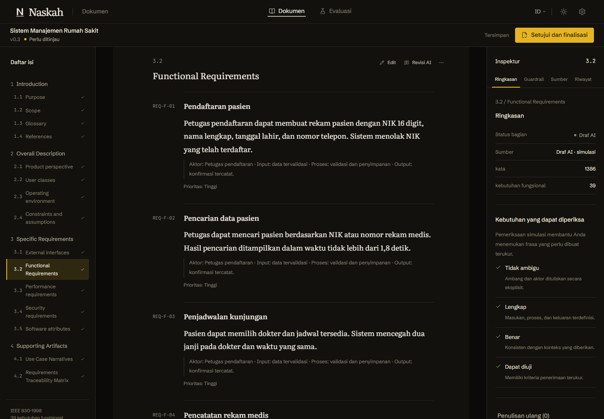
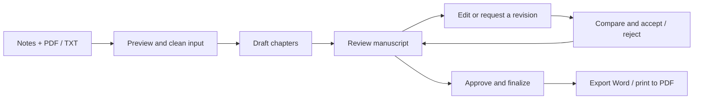
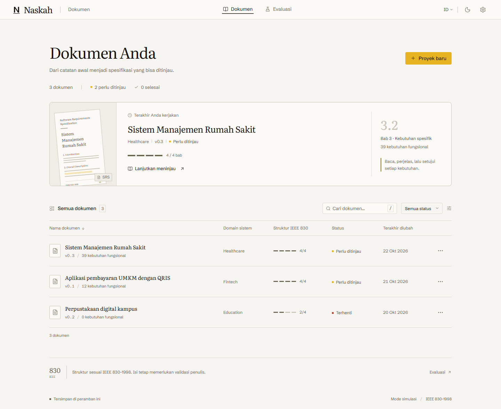
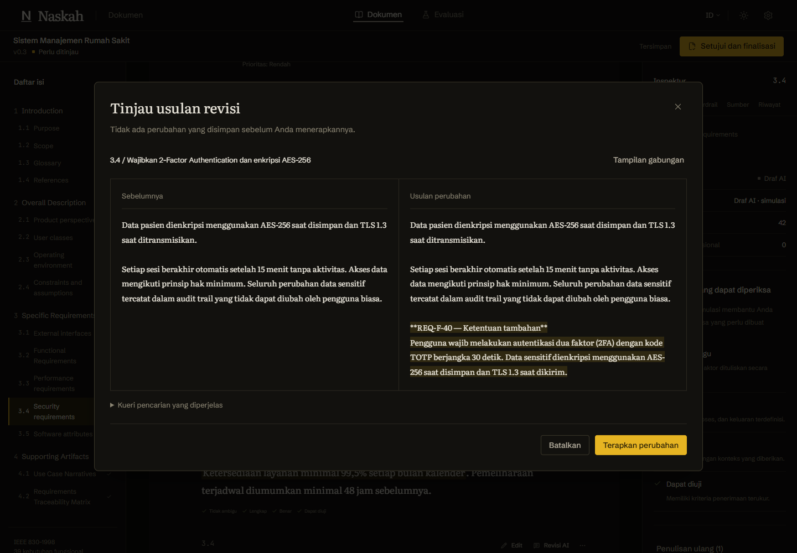
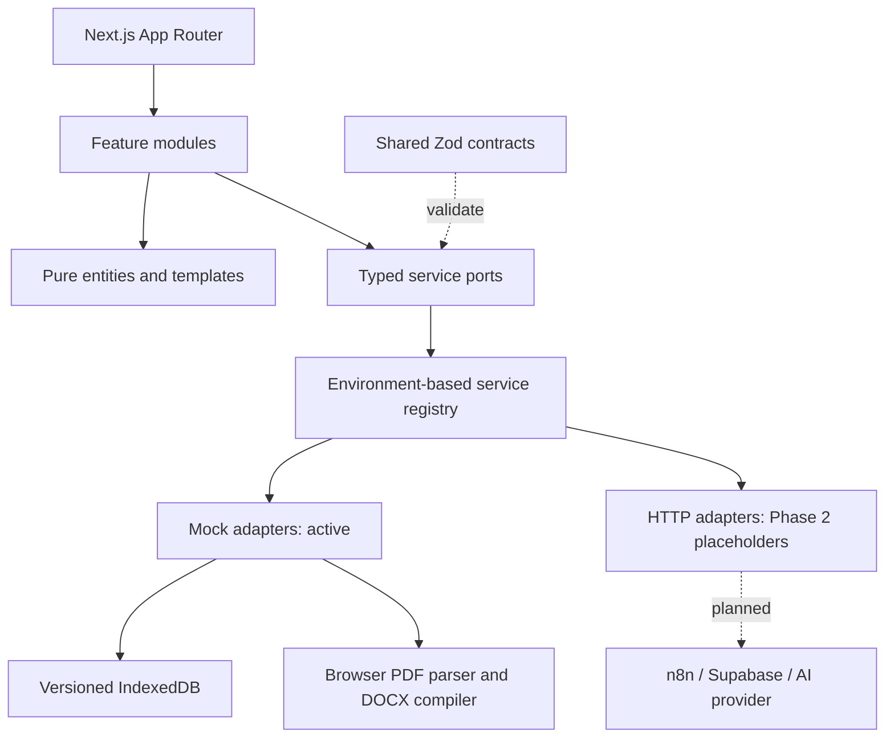

<div align="center">

# Naskah

**From working notes to requirements you can review.**

Penyusun draf SRS berstandar IEEE 830

A manuscript workspace for drafting, reviewing, and exporting software requirements.
Built for a human reviewer to stay in control, one section at a time.


[Get started](#get-started) · [Features](#the-review-workflow) · [Architecture](#architecture) · [Roadmap](#roadmap) · [Documentation](#documentation)

</div>



> **Current release: a functioning local UI with simulated AI.** Editing, browser storage, PDF text extraction, Word export, and evaluation calculations work locally. Generation, retrieval, guardrails, and AI revision use deterministic examples. Live AI and backend services are planned for Phase 2.

## Why Naskah

Requirements start as conversations, interview transcripts, and scattered notes. They become useful when someone can organize them, question ambiguous language, review a proposed change, and keep a record of what was approved.

Naskah puts that review process at the center. The workspace follows an IEEE 830-1998 document structure, keeps requirement identifiers beside the manuscript, and places quality checks, reference excerpts, and version history in an inspector. Revisions are proposals: the reviewer compares the text before applying it.

The interface defaults to **Bahasa Indonesia**, includes **English**, and supports light and dark themes throughout the working screens and dropdown menus.

## The review workflow



_Chapter drafting and AI revision currently run through the mock service layer._

| Workspace               | What you can do                                                                                                                                                |
| ----------------------- | -------------------------------------------------------------------------------------------------------------------------------------------------------------- |
| **Project ledger**      | Find documents, filter by status, inspect progress, and return to a working draft. Three demonstration projects are available on first launch.                 |
| **Source intake**       | Combine typed notes with PDF/TXT files, extract and clean text, and inspect the merged input before creating a document.                                       |
| **Chapter drafting**    | Follow retrieval, drafting, quality-check, and assembly stages. Completed chapters are preserved when a simulated run fails.                                   |
| **Manuscript review**   | Navigate the chapter outline, edit Markdown inline, inspect requirements and sources, approve sections, and restore previous versions.                         |
| **Revision proposals**  | Request a change to a target section, compare a word-level diff, and accept or reject it. Locked sections and stale proposals are checked before application.  |
| **Document delivery**   | Finalize a reviewed draft, download a generated `.docx`, or use the dedicated print view to save a PDF through the browser.                                    |
| **Research evaluation** | Review generation logs, complete expert assessments and the ten-item System Usability Scale (SUS), and import ROUGE or statistical results.                    |
| **AI settings**         | Enter a provider, model, HTTPS base URL, and masked API key. Save configuration, show/hide or remove the key, and run an explicitly simulated connection test. |

### A proofreading desk, on screen

The visual system uses manuscript typography, warm neutral surfaces, thin rules, and a restrained gold marker. **Literata** carries document text and headings, **Schibsted Grotesk** carries the interface, and **JetBrains Mono** carries identifiers. Fonts are hosted with the application.

<table>
  <tr>
    <td width="50%"></td>
    <td width="50%"></td>
  </tr>
  <tr>
    <td align="center">A ledger for your working documents</td>
    <td align="center">Review changes before they reach the manuscript</td>
  </tr>
</table>

More desktop and mobile views are in the [screenshot gallery](docs/screenshots/).

## Get started

### Prerequisites

- **Node.js** installed. The reference development environment uses Node.js `26.7.0`.
- **pnpm `11.25.0`**, pinned in the root `package.json`, or npm's `npx` to invoke that version.
- A current browser with IndexedDB support.

Phase 1 requires **no API key, database, Docker container, or backend setup**. Run commands from the repository root.

### Clone and run

```bash
git clone https://github.com/didrarayyan/Naskah.git
cd Naskah
pnpm install --frozen-lockfile
pnpm dev
```

Open **[http://127.0.0.1:3000](http://127.0.0.1:3000)**.

<details>
<summary><strong>Windows PowerShell: pnpm is missing or npx.ps1 is blocked</strong></summary>

Use the `.cmd` entry point to run the pinned package manager:

```powershell
npx.cmd --yes pnpm@11.25.0 install --frozen-lockfile
npx.cmd --yes pnpm@11.25.0 dev
```

This avoids PowerShell's blocked `npx.ps1` entry point without changing your execution policy. The same prefix works for other scripts, for example `npx.cmd --yes pnpm@11.25.0 build`.

</details>

### Try the complete flow

1. Open a demonstration project to explore a populated manuscript, or create a new project.
2. Add notes or a PDF/TXT source and review the cleaned input.
3. Start drafting and watch the simulated chapter stages complete.
4. Edit a section, request a sample revision, and compare the proposal before accepting it.
5. Approve the document and export Word, or print to PDF.
6. Visit **Settings → AI connection** to explore the configuration form and simulated connection test.

Settings also includes a local-data reset. It removes local projects, history, evaluation responses, and AI configuration; export documents you need before using it.

### Production build

```bash
pnpm build
pnpm start
```

The build script targets `apps/web`. Dependency install scripts are explicitly approved in [`pnpm-workspace.yaml`](pnpm-workspace.yaml), including `@parcel/watcher` and `@swc/core`, for pnpm 11 installations such as the Netlify build environment.

A deployed Phase 1 instance still uses browser-local data and simulated AI. Successful hosting does not enable the Phase 2 adapters.

## What works today

| Area                               | Current behavior                                                                                                                                       |
| ---------------------------------- | ------------------------------------------------------------------------------------------------------------------------------------------------------ |
| Text extraction and input cleaning | Actual browser-side PDF/TXT processing.                                                                                                                |
| Editing, approvals, and versions   | Actual document mutations and local persistence.                                                                                                       |
| Word and PDF delivery              | Actual DOCX generation; PDF output uses the browser's print dialog.                                                                                    |
| SUS and evaluation tools           | Actual scoring and import/assessment flows; seeded research results are examples.                                                                      |
| Generation and AI revision         | Deterministic fixtures, including handwritten examples for 2FA/AES-256, QRIS, and audit trails. Arbitrary instructions do not invoke a language model. |
| Retrieval and guardrails           | Simulated reference excerpts and quality reports.                                                                                                      |
| AI connection test                 | Local validation and simulated success. The provider has not verified the key or model, and no provider request is sent.                               |
| Backend endpoints                  | Contract-validated placeholders. Valid requests receive `501 Not Implemented`; schema-validated routes reject malformed requests with `400`.           |

Example baselines, fixed A/B mappings, and seeded metrics demonstrate the research interface. They are not empirical study results. See the [implementation report](docs/phase-report.md) for known limitations and the recorded performance budget gap.

## Architecture

Naskah is a pnpm monorepo with thin Next.js routes, feature modules, pure domain logic, shared contracts, and replaceable service adapters.



Features access services through `useServices`; only the registry selects an adapter. ESLint enforces the feature-to-adapter import boundary. Repository mutations use a serialized copy-on-write queue, and persistence must succeed before in-memory document state is replaced.

Generation and revision requests have shared schemas. The AI configuration service has separate write-only credential input and sanitized settings output, keeping credentials outside document-generation payloads.

### Repository map

```text
Naskah/
├── apps/web/src/
│   ├── app/                 Routes, layouts, and API placeholders
│   ├── features/            Ledger, intake, workspace, revision, export, evaluation, settings
│   ├── entities/            Document, requirement, revision, template, and evaluation logic
│   ├── services/            Ports, registry, mock adapters, and HTTP placeholders
│   └── shared/              UI primitives, tokens, configuration, localization, and utilities
├── packages/contracts/      Shared Zod schemas and inferred TypeScript types
├── tests/                   Domain/service tests and Playwright browser flows
├── scripts/                 Asset preparation, design audit, and contrast checks
├── docs/                    Architecture, decisions, traceability, reports, and screenshots
├── n8n/                     Workflow documentation and chapter prompt scaffolds
├── supabase/                Initial SQL migration scaffold
├── ingestion/               Reference-data ingestion plan
├── compiler-service/        Future server-side document compiler plan
├── evaluation-scripts/      Research evaluation plan
└── infra/                   Inert Docker Compose scaffold
```

The integration directories are not started by the UI.

### Technology choices

| Layer                 | Implementation                                                          |
| --------------------- | ----------------------------------------------------------------------- |
| Application           | Next.js 16 App Router, React 19, strict TypeScript 5.9                  |
| UI                    | Tailwind CSS v4, semantic CSS tokens, Radix UI primitives, Lucide icons |
| Language and theme    | `next-intl`, `next-themes`                                              |
| Contracts             | Zod schemas shared across features and adapters                         |
| State and persistence | Zustand preferences, versioned IndexedDB via `idb-keyval`               |
| Document tooling      | PDF.js, lazy-loaded Markdown editor, `diff`, and `docx`                 |
| Verification          | Vitest, Playwright, ESLint, design audit, and contrast checks           |

## Configuration and data

### Environment

Default development runs in mock mode without an environment file. To prepare a local configuration file:

```powershell
Copy-Item .env.example apps/web/.env.local
```

On macOS/Linux, use `cp .env.example apps/web/.env.local`.

| Variable                                                         | Purpose                                                                                                   |
| ---------------------------------------------------------------- | --------------------------------------------------------------------------------------------------------- |
| `NEXT_PUBLIC_DATA_MODE`                                          | `mock` by default. `live` selects the unfinished HTTP adapters.                                           |
| `NEXT_PUBLIC_ENABLE_DEVTOOLS`                                    | Set to `true` to expose developer controls in a production build. Development enables them automatically. |
| `N8N_BASE_URL`, `N8N_WEBHOOK_SECRET`                             | Server-side orchestration configuration for Phase 2.                                                      |
| `SUPABASE_URL`, `SUPABASE_ANON_KEY`, `SUPABASE_SERVICE_ROLE_KEY` | Database/authentication integration configuration for Phase 2.                                            |
| `DEEPSEEK_API_KEY`                                               | Server-side AI provider credential for Phase 2.                                                           |

Changing the data mode does not implement the backend. Missing live configuration shows a configuration screen; configured live adapters deliberately report `NotImplementedError`.

Never add a `NEXT_PUBLIC_` prefix to server secrets. Local environment files are ignored by Git.

### Storage boundaries

| Data                                                   | Location         | Lifetime                                                                                                                  |
| ------------------------------------------------------ | ---------------- | ------------------------------------------------------------------------------------------------------------------------- |
| Projects, document sections, versions, evaluation data | IndexedDB        | Across reloads in the same browser profile and origin, until reset or cleared.                                            |
| Provider, model, and API base URL                      | IndexedDB        | Across reloads, until reset or changed.                                                                                   |
| Language, theme, and display preferences               | Browser storage  | Across visits to the same origin.                                                                                         |
| Intake draft                                           | `sessionStorage` | The browser tab session.                                                                                                  |
| AI API key entered in Settings                         | Tab memory only  | Cleared on refresh, removal, or local-data reset. Changing provider or endpoint without a replacement key invalidates it. |

Local storage is not an account, a cross-device sync service, or a backup. A hosted site and `localhost` have separate storage. Export documents before clearing browser data.

## Development and verification

| Command               | Purpose                                                       |
| --------------------- | ------------------------------------------------------------- |
| `pnpm dev`            | Start the local Next.js development server.                   |
| `pnpm typecheck`      | Check strict TypeScript types.                                |
| `pnpm lint`           | Check code style rules and feature/service import boundaries. |
| `pnpm test`           | Run Vitest domain, service, and contract tests.               |
| `pnpm test:e2e`       | Run browser flows in both light and dark themes.              |
| `pnpm build`          | Produce the Next.js production build.                         |
| `pnpm start`          | Serve an existing production build.                           |
| `pnpm audit:slop`     | Check project-specific visual conventions.                    |
| `pnpm check:contrast` | Check declared text/background color pairings.                |

The browser suite defaults to **Microsoft Edge** (`msedge`). Start the app in one terminal with `pnpm dev`, then run `pnpm test:e2e` in another.

<details>
<summary><strong>Use another browser or local port</strong></summary>

For an installed Chrome browser:

```powershell
$env:PLAYWRIGHT_CHANNEL = "chrome"
pnpm test:e2e
```

For Playwright-managed Chromium:

```powershell
pnpm exec playwright install chromium
$env:PLAYWRIGHT_CHANNEL = "chromium"
pnpm test:e2e
```

If the app is running on another port:

```powershell
$env:PLAYWRIGHT_BASE_URL = "http://127.0.0.1:3002"
pnpm test:e2e
```

Screenshot flows write to `docs/screenshots/`. Failure traces are retained according to `playwright.config.ts`.

</details>

Tests cover document contracts, input cleaning, requirement identifiers, SUS scoring, revision isolation, locked/stale proposals, generation recovery, DOCX contents, and AI credential handling. Browser flows exercise intake through export, responsive views, language switching, and Settings behavior.

Developer controls are available through Settings or **Ctrl + Shift + D** when enabled. They expose simulation speed, failure injection, example loading, and recent port calls. The [design system page](apps/web/src/app/design-system/page.tsx) is available at `/design-system` during local exploration.

## Roadmap

- [x] Local document workflow: intake, drafting simulation, editing, review, and finalization.
- [x] Section-level revision proposals, diffs, approval checks, and version history.
- [x] Browser PDF extraction, Word export, and print-to-PDF.
- [x] Indonesian/English interface, light/dark themes, and theme-aware dropdowns.
- [x] AI Settings UI, shared schemas, service port, and explicit API placeholders.
- [x] Research evaluation screens and automated verification tooling.
- [ ] Authenticated backend and owner-scoped persistence.
- [ ] Secure server storage of AI credentials and real provider connection tests.
- [ ] n8n orchestration, live chapter generation, and targeted AI revision.
- [ ] Supabase/pgvector retrieval with document-level training/evaluation separation.
- [ ] Server document compilation and reproducible research evaluation.

The [backend roadmap](docs/backend-roadmap.md) defines the implementation order and acceptance checks. Backend work should replace adapters behind the existing ports, then validate the contracts and browser flows against real services.

## Documentation

| Guide                                           | What it explains                                                    |
| ----------------------------------------------- | ------------------------------------------------------------------- |
| [Architecture](docs/architecture.md)            | Module boundaries, persistence, events, and adapter selection.      |
| [Shared contracts](docs/contracts.md)           | Request/response schemas and integration boundaries.                |
| [Backend roadmap](docs/backend-roadmap.md)      | Phase 2 services, credential handling, and acceptance checks.       |
| [Functional traceability](docs/traceability.md) | Requirement-to-screen, port, and verification mapping.              |
| [Implementation report](docs/phase-report.md)   | Delivered scope, verification history, simulations, and known gaps. |
| [Design plan](docs/design-plan.md)              | The proofreading-desk layout, typography, and visual decisions.     |
| [Workflow notes](n8n/README.md)                 | Planned generation and revision orchestration.                      |
| [Original UI brief](UI%20DEVELOPMENT.md)        | The project specification that informed Phase 1.                    |

## Working on Naskah

Keep routes thin, place pure logic in `entities`, and access services through the typed ports. Add interface copy to both locale dictionaries, reuse semantic design tokens, and preserve keyboard navigation when changing controls. Heavy document tools should stay lazy-loaded.

For a change, describe the affected workflow, verify the relevant type/lint/test checks, and include screenshots when the interface changes. Read [`CLAUDE.md`](CLAUDE.md) for repository conventions and the nearest `AGENTS.md` before editing application code.

---

<div align="center">

**Naskah** · Working notes. Structured requirements. Human review.

</div>
