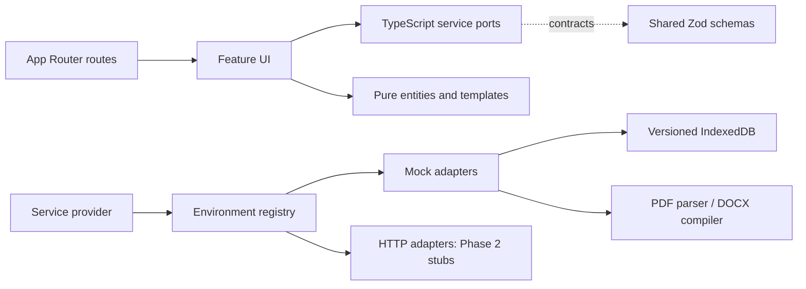

# Architecture

Routes render feature entry points. The root layout configures fonts and shared
styles; API routes validate contracts. Features use `useServices`, whose type
is the port collection. Only `services/registry.ts` selects adapters. Entities
have no React, Next, or service imports. The ESLint boundary rule prevents
features from importing mock/HTTP internals. Feature-to-feature imports use
the public index (the workspace shares the revision viewer).

Generation emits retrieval, stage, section, guardrail, completion and failure
events. The adapter saves each chapter before announcing it. UI state is
refreshed from the repository on section events. Failed jobs preserve completed
sections; retry only processes pending sections. Handles are shared per session
so navigating to a running workspace does not start a second job.

Repository mutations use a serialized copy-on-write queue. IndexedDB writes
must succeed before the new database replaces the in-memory copy. Revision
application checks both the lock and original text to reject stale proposals.
Snapshots are immutable; restoring creates a new version.

Domain contracts are in `packages/contracts/src/index.ts`. The persisted envelope
has schema version 1. Unsupported versions show an explicit recovery error;
no data is silently migrated or discarded. Browser storage failures are typed.

Client dependencies are loaded per route; PDF.js, the Markdown editor, `docx`
and `diff` load only when used. Long manuscript sections use browser
content-visibility containment. Fonts are built and self-hosted with next/font.

The URL controls selected section and inspector panel. Preferences use small
Zustand selectors. IndexedDB is the source of truth for application entities.
